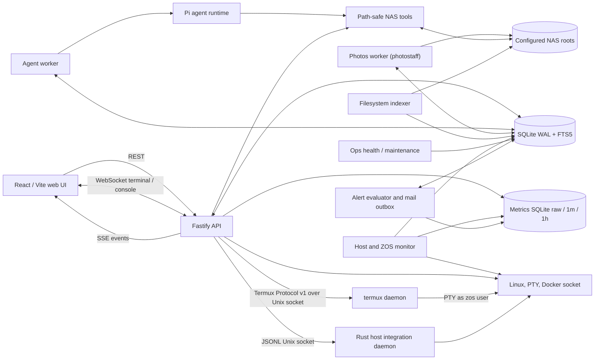

<p align="center">
  
</p>

<h1 align="center">ZOS</h1>

<p align="center">
  A local-first Linux NAS appliance with a web workspace, approval-gated AI operations, search, and host management.
</p>

ZOS is a single-user control plane for a personal Linux NAS. It combines a responsive file workspace with an AI agent, keeps state in a local SQLite database, and runs as a set of native `systemd` services instead of inside containers.

The project combines a strict TypeScript npm-workspaces application with Rust storage daemons. Its production target is Node.js 22 and Rust 1.95 on Debian-based systems, with a React/Vite frontend and a Fastify API.

## Project status

ZOS is under active v1 development. The file and photo workspaces, agent job pipeline, approvals, indexing, Docker controls, share configuration, Debian packaging, and scheduled maintenance paths are implemented.

The following surfaces are intentionally limited today:

- Virtual machine management supports libvirt/QEMU host discovery and approval-gated lifecycle operations when the optional runtime is installed.
- Network inspection remains available on every supported backend; NetworkManager Wi-Fi/hotspot changes and approved storage-pool operations are applied through `zos-hostd` when their host dependencies are available.
- OCR is opt-in per NAS root and is limited to scanned PDFs with insufficient embedded text.
- Local restic backup is opt-in; after explicit repository initialization, daily/weekly services perform encrypted snapshots and staging-only restore.
- The appliance builder produces a generic root filesystem tarball, not a board-specific boot image.

## What is implemented

### File workspace

- Browse multiple configured NAS roots with breadcrumb navigation and Git status indicators.
- Search the SQLite FTS index with a filesystem name-search fallback.
- Incrementally refresh the index from file size and modification time without following symbolic links.
- Preview text, source code, Markdown, CSV/TSV, images, audio, video, and PDF files.
- Transcode unsupported browser video containers to a local MP4 cache with FFmpeg.
- Edit bounded text files with modification-time conflict detection.
- Upload files and folders, including drag-and-drop batches with progress and cancellation.
- Extract ZIP, TAR, TAR.GZ, GZIP, and RAR archives with traversal, symlink, entry-count, and expanded-size checks.
- Propose folder creation, rename, move, copy, and trash operations for explicit approval.
- Review operation history, restore quarantined files, and roll back supported operations.

### AI workspace

- Persistent chat sessions scoped to a NAS root, with independent workspace navigation state.
- A database-backed job queue processed by a separate worker.
- Pi agent integration with OpenAI, Anthropic, and compatible custom base URLs.
- Streaming job and tool activity over Server-Sent Events.
- Per-tool policy controls for `read`, `grep`, `find`, `ls`, `bash`, `edit`, and `write`.
- Approval records for dangerous Pi tool calls before execution.
- A model-free, read-only local fallback for development and testing.

### Photos library

- Bind one directory on a mounted storage pool and index common images, videos, and RAW camera files recursively.
- Build a chronological EXIF-first media timeline with cached WebP thumbnails and previews, plus in-panel video playback.
- Upload with SHA-256 duplicate detection, view metadata, download originals or ZIP selections, and request approval-gated batch move/trash operations.
- Run resumable immediate and periodic scans in the non-root internal Rust `photostaff` daemon, with worker heartbeats, bounded media tools, and journaled derivative publication.

### Host management

- Read-only CPU, memory, process, runtime, storage, SMART, RAID, mount, and network reporting.
- A local PTY terminal over WebSocket using a separately configured non-root host user (the API remains `zos`).
- Optional Docker Engine and Compose discovery, metrics, logs, lifecycle actions, direct container/volume/network creation, and one-time approved console sessions.
- Approval-gated SMB, WebDAV, FTP, NFS, and DLNA share configuration through the privileged Rust `zos-hostd` daemon.
- English and Simplified Chinese UI, light/dark themes, preview limits, and editor font settings.

### Native appliance services

- Debian package definitions for `amd64` and `arm64` release artifacts.
- Hardened `systemd` units for the API, Rust monitor/alerter, worker, indexer, one-shot operations, and `zos-hostd`.
- Timers for daily/weekly restic backups, health evaluation every 15 minutes, and maintenance at 04:30; the resident indexer reconciles internally every 30 minutes.
- A Debian Bookworm rootfs scaffold built with `mmdebstrap` and `systemd-nspawn`.

## Architecture



The main runtime components are:

| Component | Responsibility |
| --- | --- |
| `apps/web` | React 19 workspace UI, previews, settings, activity, and management panels. |
| `apps/api` | REST API, SSE event feed, WebSocket terminals, static production UI, and approved operation execution. |
| `apps/worker` | Claims queued jobs, runs agent turns, persists events, and pauses work for approvals. |
| `apps/photostaff` | Rust media worker with resumable scans, metadata extraction, and journaled image derivatives. |
| `apps/indexer` | Walks NAS roots, hashes files, extracts bounded text, and maintains the FTS index. |
| `apps/ops` | Runs one-shot health evaluation and safe maintenance with persisted lifecycle history. |
| `apps/monitor` | Rust metrics collector: collection, rollups, retention, and metrics database capacity protection. |
| `apps/alerter` | Rust alert engine: rule evaluation, incidents, escalation, health synchronization, and mail delivery. |
| `crates/monitoring-contracts` | Shared Rust metric catalog, schema version, and sampling cadence contract. |
| `apps/hostd` | Rust host integration daemon for approved shares, storage, Docker daemon, and NetworkManager changes. |
| `apps/termux` | Rust terminal daemon for native PTYs and persistent tmux sessions under the non-root `zos` account. |
| `packages/agent` | Pi SDK integration, NAS-scoped tools, session persistence, and tool policy enforcement. |
| `packages/db` | SQLite connection, migrations, repositories, job queue, approvals, operations, and FTS queries. |
| `packages/monitoring` | Language-neutral metric contracts plus TypeScript read-only metrics queries. |
| `packages/nas-tools` | Root-relative path validation, symlink escape protection, file reads, metadata, and mutations. |
| `packages/shared` | Configuration loading and shared domain/API types. |

### Agent and approval flow

1. The browser creates a session message through the API.
2. The API stores the message and a queued job in SQLite.
3. The worker claims the job and starts a Pi agent turn scoped to the selected NAS root.
4. Agent and tool events are appended to SQLite and streamed to the browser over SSE.
5. A policy-gated tool call or proposed mutation creates a pending approval and pauses execution.
6. The API applies or rejects the operation after the user acts, then records the outcome for audit and rollback.

File operations proposed through the workspace or agent, Pi tool calls, Docker lifecycle/Compose operations, and share-service changes use this approval path. Docker resource creation from the management panel executes after final confirmation and is recorded in operation history; direct UI uploads, text saves, and archive extraction are also path-checked and recorded.

## Security model

ZOS currently assumes a trusted, single-user appliance. It has no multi-user authentication boundary and binds the API to `127.0.0.1` by default. Do not expose it directly to an untrusted network.

- Every NAS file path is resolved relative to a configured root; absolute paths, traversal, and unsafe symlink escapes are rejected.
- File-oriented agent tools use NAS-root-scoped ZOS wrappers. The `bash` tool is a real service-account shell, is always approval-gated, and is not a filesystem sandbox.
- Write-capable Pi tools default to approval or disabled policies, configurable from the UI.
- Approved file changes are audited. Trash uses a ZOS-managed quarantine area, and v1 never permanently deletes it during maintenance.
- Docker management is disabled by default. Access to `/var/run/docker.sock` is effectively root-equivalent.
- The local terminal is a real interactive login shell running through Rust `apps/termux` as the non-root `zos` user. The API service also runs as `zos`; `NoNewPrivileges` and an empty capability set prevent terminal `sudo` escalation.
- Privileged host changes are isolated in Rust `apps/hostd`, which accepts versioned JSONL requests over an authenticated Unix socket and only performs allowlisted operations.

Always configure at least one explicit NAS root. When no root is provided, the development fallback is the host filesystem root.

## Requirements

For application development:

- Node.js 22 or newer
- npm (the version bundled with Node.js 22 is supported)
- Rust 1.95.0 (pinned by `rust-toolchain.toml`)
- A compiler toolchain supported by the native `better-sqlite3` dependency when a prebuilt binary is unavailable

Optional host tools enable additional features:

| Feature | Host dependencies |
| --- | --- |
| Git status | `git` |
| Video thumbnails and playback | `ffmpeg` |
| RAW photo thumbnails and previews | `libraw-bin` (`dcraw_emu`) |
| HEIC/HEIF photos | `libheif-examples` (`heif-convert`) |
| Archive extraction | `gzip`, `unzip`, `tar`, `bsdtar`, or `unrar` as appropriate |
| Storage and network inspection | `ip`, `lsblk`, `findmnt`, `mdadm`, `smartctl` |
| Share management | Samba, Apache WebDAV, vsftpd, NFS server, MiniDLNA, and the packaged `zos-hostd` daemon |
| Docker management | Docker Engine socket access and the Docker CLI for Compose actions; enable explicitly on an appliance |
| Virtual machines | `libvirt-daemon-system`, `libvirt-clients`, `qemu-system-arm` and `qemu-efi-aarch64` (arm64) or `qemu-system-x86` (amd64), `qemu-utils`, `virtinst`, and `ipxe-qemu` |

## Local development

Install dependencies, create an isolated development NAS root, and export the configuration read by the Node.js processes:

```bash
npm install
mkdir -p .zos/dev-root/data/primary
export ZOS_ROOT="$PWD/.zos/dev-root"
export ZOS_NAS_ROOTS="dev:Development NAS:$PWD/.zos/dev-root/data/primary"
npm run dev
```

Open [http://127.0.0.1:5173](http://127.0.0.1:5173). Vite proxies `/api`, `/health`, and WebSocket traffic to the API at `127.0.0.1:3010`.

`npm run dev` starts the API, agent worker, internal Rust `photostaff`, Rust downloader, Rust VOD player, and web UI. The Rust services use the API-owned TypeScript migrations and wait for their required schema versions before claiming work. The indexer and one-shot operations remain explicit during development:

```bash
npm run index
npm run health
npm run maintenance
```

The Starlight documentation site is built separately with `npm run docs:build` and is served by the production API at `http://127.0.0.1:3010/docs/` when its static output is present. Use `npm run docs:dev` for the standalone documentation development server.

The packaged Rust `zos-indexer.service` is resident: filesystem events and mutation queues normally make changes searchable within seconds, while a full reconciliation runs every 30 minutes. Run `npm run index` for a one-shot development refresh. A failed extraction retains its last successful body, and an incomplete traversal never removes stale entries that could not be verified.

Inspect the latest run for every configured root, or one root, through the read-only status endpoint:

```bash
curl http://127.0.0.1:3010/api/indexer/status
curl "http://127.0.0.1:3010/api/indexer/status?rootId=dev"
```

Status responses include scan metrics and root-relative failures plus daemon heartbeat, watcher, durable queue, and compatibility rebuild state. Symbolic links are always skipped. Text, PDF, DOCX, XLSX, PPTX and root-enabled PDF OCR extraction feed the FTS5 search index.

Configure an OpenAI or Anthropic provider, model, and API key in **Settings > Model Providers** before starting an AI turn. Provider secrets are stored in the local SQLite database; API reads only report whether a key is configured.

For a model-free read-only development agent, set this before starting the worker:

```bash
export ZOS_ENABLE_LOCAL_AGENT_FALLBACK=1
```

The backend reads process environment variables directly; `.env.example` is a reference file and is not automatically loaded by the Node.js services.

## Configuration

Production services read TOML from the fixed path `/zos/config/config.toml`. Development can override the location with `ZOS_CONFIG`. See [`config.example.toml`](config.example.toml) and [`packaging/etc/config.toml`](packaging/etc/config.toml) for the supported baseline.

A minimal configuration is:

```toml
root_dir = "/zos"
environment = "production"

[api]
host = "127.0.0.1"
port = 3010
allowed_origins = []

[worker]
poll_ms = 750

[docker]
enabled = false
socket_path = "/var/run/docker.sock"
compose_command = "docker"
operation_timeout_ms = 120000
console_shells = ["/bin/sh", "/bin/bash"]

[hostd]
socket_path = "/run/zos/hostd.sock"

[shares]
enabled = false
account_username = "zos-share"

[[nas_roots]]
id = "primary"
name = "Primary NAS"
path = "/zos/data/primary"
```

Environment variables override the corresponding TOML values. The most useful development overrides are `ZOS_ROOT`, `ZOS_API_HOST`, `ZOS_API_PORT`, `ZOS_ALLOWED_ORIGINS`, `ZOS_NAS_ROOTS`, and the `ZOS_DOCKER_*` variables documented in [`.env.example`](.env.example). `ZOS_DATA_DIR` and `ZOS_DATABASE_PATH` are intentionally unsupported because state is derived from the single ZOS root.

## Build and verification

### P0 operations

Production mode requires loopback API binding, the exact root `/zos`, and mounted NAS roots as direct children of `/zos/data`. The indexer records progress, failures and readiness in the main SQLite database. The monitor writes host and ZOS time series only to `/zos/state/metrics.sqlite`; the alerter reads those metrics and stores configuration, incidents, and its mail outbox in `zos.sqlite`. Inspect the system with `/api/indexer/status`, `/api/roots/readiness`, `/api/system/health`, `/api/monitoring/overview`, and `/api/monitoring/alerts/summary`.

Local restic backup is opt-in. Configure a repository and protected password file, run `backup validate`, then explicitly run `backup init`. Daily and weekly timers never initialize repositories implicitly. Restore always writes to isolated staging and never promotes over an active NAS root.

```bash
npm run typecheck
npm run lint
npm test
npm run build
```

ZOS uses one SemVer across the root manifest, application and package workspaces, Debian package, and appliance manifest. Prepare a release from a clean worktree with:

```bash
npm run release -- patch --note "Describe the operator-visible change"
```

Use `minor` or `major` when appropriate. The command only updates version sources and the Debian changelog; it does not commit, tag, push, or publish. Review and commit the resulting diff, create the matching `v<version>` tag separately, and use `npm run version:check` to validate consistency. Runtime, configuration, script, and packaging changes require a monotonic version bump relative to the comparison base; documentation, tests, and CI-only changes may share the next product release.

Every build writes `.zos/build-info.json` with the product version, commit SHA, tag or branch, build time, build source, and dirty state. The API exposes the public subset at `/api/system/build-info`, and the web UI shows it under Settings > Version. Debian packages install the immutable metadata at `/usr/lib/zos/build-info.json`.

The equivalent Make targets are available through `make check` and `make ci`. The production API serves `apps/web/dist` when it is present, so a source build can be run with the API and worker in separate shells:

```bash
npm run start -w @zos/api
npm run start -w @zos/worker
```

## Debian package and appliance image

On a Debian or Ubuntu build host with Node.js 22, `build-essential`, `debhelper`, `dpkg-dev`, `fakeroot`, and `rsync` installed:

```bash
make deb
```

Package artifacts are written under `.zos/`. The package installs the built applications under `/usr/lib/zos`, configuration under `/zos/config`, persistent state under `/zos/state`, and the service units under `/lib/systemd/system`.

To build the generic Debian Bookworm rootfs tarball, install `mmdebstrap`, `systemd-nspawn`, and `tar`, then point the appliance builder at the architecture-matching package:

```bash
ZOS_DEB=/absolute/path/to/zos_<version>_arm64.deb make appliance
```

See [`packaging/appliance/README.md`](packaging/appliance/README.md) for image-builder inputs. Tagged releases are configured to publish `amd64` and `arm64` Debian artifacts with checksums through GitHub Actions.

### Install on a Raspberry Pi OS or Debian host

For an `arm64` CM5 (or an `amd64` Debian host), run the host installer from a checkout as root:

```bash
sudo ZOS_NAS_ROOT_PATH=/zos/data/primary packaging/scripts/install.sh
```

The installer checks the Debian architecture, switches Debian and Raspberry Pi APT entries to domestic mirrors, installs Node.js 22 from the verified Aliyun Node.js release mirror when needed, installs the pinned Rust 1.95.0 toolchain through rustup, and configures npm to use `https://registry.npmmirror.com`. It then builds the package on the target host and initializes first-boot configuration only for a new installation. Building on the target keeps the Rust daemons, `better-sqlite3`, and OCR helpers compatible with the board. It starts the ZOS API, monitor, alerter, worker, hostd, termux, downloader, indexer, and an Nginx reverse proxy on port 80 by default; maintenance, health, and backup timers remain scheduled tasks. The API remains loopback-only and Nginx is the LAN entry point.

The mirror defaults can be overridden for a private mirror or restored to another mirror with `ZOS_APT_MIRROR`, `ZOS_APT_SECURITY_MIRROR`, `ZOS_RPI_MIRROR`, `ZOS_NODE_MIRROR`, `ZOS_NODE_VERSION`, and `ZOS_NPM_REGISTRY`. The installer only rewrites known Debian/Raspberry Pi URIs, saves original source files under `/zos/system-backups/apt`, preserves `signed-by`, suites, components, and unrelated sources, and disables any NodeSource entry after switching to the domestic Node.js binary distribution. To restore an original source, copy its backup from `/zos/system-backups/apt` back to `/etc/apt/sources.list.d` (or uncomment the marked NodeSource line) before running the installer again with an explicit `ZOS_NODE_MIRROR`.

The installer also normalizes the host locale to `C.UTF-8` by default and stops OpenSSH from accepting invalid wildcard `LC_*` values from clients, such as `LC_CTYPE=UTF-8`. Original locale and SSH configuration files are saved under `/zos/system-backups`; override the default with `ZOS_LOCALE` when a generated locale is available.

Set `ZOS_NGINX_PORT` to choose another listener port, or set `ZOS_ENABLE_NGINX=0` to keep the API loopback-only and skip Nginx installation.

Docker and VM runtimes are opt-in because Docker socket access is root-equivalent. Enable both during installation with `ZOS_ENABLE_DOCKER=1 ZOS_ENABLE_VM=1`; the installer installs the Docker engine, CLI, Compose plugin, and matching QEMU/libvirt packages, writes the feature flags, refreshes API access to the `docker`, `libvirt`, and `kvm` groups, grants the ZOS service account the non-interactive libvirt polkit action, starts the runtime services, and autostarts the standard libvirt `default` NAT network when it is available.

Optional integrations are listed as Debian `Suggests` rather than hard dependencies. The package includes the required `ffmpeg` and `libraw-bin` media tools; install other host tools you need (for example `git`, `restic`, Samba, or NFS) separately. The core package does not enable optional services implicitly.

## Repository layout

```text
apps/
  api/            Fastify API and host adapters
  backup/         Restic validate, backup, check, and staging restore CLI
  hostd/          Rust privileged host integration daemon
  indexer/        NAS scanner and SQLite FTS indexer
  ops/            One-shot health evaluation and maintenance
  termux/         Rust PTY daemon with tmux-backed terminal persistence
  web/            React/Vite user interface
  worker/         Agent job processor
packages/
  agent/          Pi runtime and policy-gated tools
  db/             SQLite schema and repositories
  nas-tools/      Path-safe NAS operations
  shared/         Configuration and shared types
packaging/
  appliance/      Rootfs image scaffold
  debian/         Debian package metadata
  systemd/        Runtime services and timers
docs/             Starlight technical, architecture, and operations documentation
```

## License

Licensed under the [Apache License 2.0](LICENSE).
