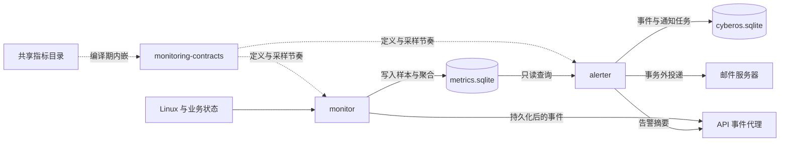

# CyberOS Rust 模块架构总览

CyberOS 的 Rust 代码位于 `crates/`，由根目录的 [Cargo workspace](../Cargo.toml) 统一构建。当前共有 13 个 crate：12 个提供常驻服务二进制，`monitoring-contracts` 提供共享库；部分服务同时包含供测试和复用的 library target。

生产环境运行原生 Linux 进程与 systemd 单元。Web、API、Agent worker 等 TypeScript 工作空间位于 `packages/`，通过 SQLite 任务表、Unix socket 和系统服务与 Rust 模块协作。

## 模块导航

每份 README 都包含一张 SVG 架构图，以及源码导航、关键流程、接口与配置、故障恢复、安全边界和开发验证方法。SVG 支持缩放，并随查看器的浅色/深色主题切换；可单独打开查看细节。

| 领域 | 模块文档 | 核心职责 | 主要交互 | 架构图 |
| --- | --- | --- | --- | --- |
| 监控 | [monitoring-contracts](monitoring-contracts/README.md) | 指标目录、采样节奏、指标库版本和身份 | 编译期 JSON、Rust 公共类型 | [SVG](monitoring-contracts/docs/architecture.svg) |
| 监控 | [monitor](monitor/README.md) | Linux 与业务状态采集、时间序列及聚合 | 观测源、metrics SQLite、事件 socket | [SVG](monitor/docs/architecture.svg) |
| 告警 | [alerter](alerter/README.md) | 规则状态机、告警事件、升级与邮件 outbox | 指标库只读、业务库、SMTP | [SVG](alerter/docs/architecture.svg) |
| 文件与媒体 | [indexer](indexer/README.md) | 文件全文索引、影视目录和音乐元数据 | 存储池只读、业务任务表、TMDB | [SVG](indexer/docs/architecture.svg) |
| 文件与媒体 | [photos](photos/README.md) | 照片扫描、元数据、缩略图和预览 | 原片只读、媒体工具、发布 journal | [SVG](photos/docs/architecture.svg) |
| 下载 | [downloader](downloader/README.md) | HTTP/BT 传输、续传、检查点及最终发布 | 下载任务、网络、存储池写入 | [SVG](downloader/docs/architecture.svg) |
| 主机集成 | [hostd](hostd/README.md) | 受限的 root 主机操作与恢复 | Unix JSONL、固定命令、D-Bus、LocalAPI | [SVG](hostd/docs/architecture.svg) |
| 主机集成 | [host-accessd](host-accessd/README.md) | 向获授权容器提供裁剪后的 Docker 元数据 | 控制 socket、授权目录、HTTP 白名单 | [SVG](host-accessd/docs/architecture.svg) |
| 终端 | [terminald](terminald/README.md) | Web Terminal 的 PTY 流与 tmux 会话 | Unix JSONL、PTY、固定用户 Shell | [SVG](terminald/docs/architecture.svg) |
| 蓝牙 | [bluetoothd](bluetoothd/README.md) | OBEX 文件发送与接收暂存 | 业务库、BlueZ OBEX、API 接收收尾 | [SVG](bluetoothd/docs/architecture.svg) |
| 音频 | [audiod](audiod/README.md) | ATVV 音频采集、内存录音与语音播放 | BlueZ GATT、Unix IPC、ALSA/BLE | [SVG](audiod/docs/architecture.svg) |
| TV 输入 | [tv-gamepad](tv-gamepad/README.md) | evdev 手柄事件转为固定 Wayland 按键 | Linux input、纯状态机、wtype | [SVG](tv-gamepad/docs/architecture.svg) |
| 本机播放 | [vod-player](vod-player/README.md) | 统一的音乐/视频所有权、队列与播放恢复 | Unix JSONL、mpv、媒体 FD、检查点 | [SVG](vod-player/docs/architecture.svg) |

## 跨模块协作

### 监控到告警



虚线表示编译或契约依赖。数据库连线表示读写方向：采集和求值由服务主动调度，数据库不会主动推送任务。实时事件服务于界面更新，历史数据与待投递任务仍以持久化存储为准。

### 后台任务与文件发布

API 接收产品操作，写入业务表或任务队列。indexer、photos、downloader 和 bluetoothd 读取各自任务并回写状态，但文件权限与最终发布方各不相同。

| 流程 | 用户文件读取/写入 | 结果与恢复方式 |
| --- | --- | --- |
| 普通文件、影视和音乐索引 | indexer 只读存储池 | SQLite 索引事务、任务租约、扫描代次；音乐封面存入 state |
| 照片处理 | photos 只读原片 | 衍生文件进入 state/photos，journal 衔接文件发布与资产提交 |
| HTTP/BT 下载 | downloader 写入指定目标池 | 检查点、空间预留、受限文件/目录发布与 journal 恢复 |
| 蓝牙接收 | bluetoothd 写入 state 暂存区 | API 重新校验配置并把完成文件发布到 NAS 收件箱 |

租约和文件身份复核用于识别任务所有者变化、原文件变化或挂载变化。它们不意味着多个进程的数据库与文件系统操作共享一个原子事务。

### 主机控制、输入与播放

API 使用各自协议连接 hostd、host-accessd、terminald、audiod 和 vod-player。它们的版本、帧大小、会话和取消语义不同，不能因为都使用 Unix socket 就共用同一套消息格式。

| 路径 | 控制职责 | 实际执行边界 |
| --- | --- | --- |
| API → hostd | 已授权的固定主机操作 | root helper、按域互斥、模块内校验与恢复 |
| API → host-accessd → Docker | 容器宿主访问授权与 reconcile | 数据面只读端点和字段裁剪；包默认未开启兼容性 |
| Web Terminal → API → terminald | 会话与字节流 | cyberos 用户、PTY attach 与私有 tmux server |
| 上层音频协调 → audiod | 输入设备、录音消费、播放与取消 | 本地音频 I/O；推理与 Agent 任务关联位于进程外 |
| API → vod-player → mpv | 音乐/视频接管、队列、焦点与进度 | 一个 Controller 串行管理共享播放所有权 |
| 手柄 → tv-gamepad → wtype | 设备输入转固定按键 | 当前 Wayland 会话；焦点与页面响应由接收方处理 |

## 数据与权限边界

| 资源 | 所有权或使用约定 |
| --- | --- |
| `/cyberos/state/cyberos.sqlite` | 由 TypeScript 数据层管理业务 schema；Rust 消费者依赖已就绪的相应表 |
| `/cyberos/state/metrics.sqlite` | monitor 初始化、写入、聚合与维护；alerter 查询 |
| `/cyberos/data/<pool>` | 业务存储池；访问需要路径、符号链接、挂载与身份校验 |
| `/cyberos/state/photos`、`music/artwork`、`bluetooth/incoming`、`vod-player` | 各服务的衍生文件、暂存或检查点；不是统一可随意清空的缓存 |
| `/run/cyberos` | 本地 IPC 和运行状态；socket 还需文件权限与 peer credential 校验 |
| 系统配置、设备与服务 | hostd 通过固定操作管理，不接受任意 Shell 命令 |

hostd 以 root 运行，其余 Rust 服务使用 `cyberos` 账号。附加组也是权限设计的一部分，例如 host-accessd 的 `docker`、audiod 的 `audio`、tv-gamepad 的 `input`。非 root 不代表天然低风险，尤其不能忽略 Docker socket 和交互式 Shell 的权限。

产品审批由调用侧保留，服务再执行自己的协议、身份和操作检查。systemd 的 `ReadWritePaths`、地址族、capability 和设备限制与 Rust 校验共同构成边界；部署条件见各模块链接的服务单元。

## 开发与验证

所有命令在仓库根目录执行。Rust workspace 要求 edition 2024、Rust 1.95 或以上；涉及 API、协议绑定与完整构建时，还需 Node.js 22.19.0 或以上、根工作空间和 docs 依赖。

```bash
npm ci
npm --prefix docs ci
cargo check --locked --workspace
cargo test --locked --workspace
```

只改某个模块时，可先执行其 README 中的 `cargo check/test -p <package>`。协议相关变更运行 `npm run protocol:check`；完整检查和构建入口是 `make ci`，其中包含 Rust、TypeScript、文档检查和构建。文档站浏览器 smoke 另行执行 `npm run docs:browser`。

数据库消费者需要已有开发 schema。首次本地运行可先创建隔离目录并使用现有初始化入口：

```bash
mkdir -p .cyberos/dev-root/data/pool-1
CYBEROS_ENVIRONMENT=development \
CYBEROS_ROOT="$PWD/.cyberos/dev-root" \
node --import tsx packages/api/src/state-init.ts
```

然后按照所选模块的前提配置测试库、任务、工具和设备。以上初始化不会自动为所有 worker 产生业务任务，也不会模拟 Linux 的存储挂载、systemd、D-Bus、evdev 或音视频硬件。

`CYBEROS_ROOT` 只隔离支持该配置的路径。hostd 还会管理真实主机资源，terminald 固定使用系统账号和 socket，vod-player 也有固定 IPC 默认值；不要把设置开发根目录当作所有服务都可以直接试跑的保证。

| 验证层级 | 可以证明 | 还需单独验证 |
| --- | --- | --- |
| 编译、类型和协议检查 | 代码可构建、静态契约一致 | 运行环境和设备能力 |
| 单元与隔离集成测试 | 指定输入下的状态、路径、恢复和协议行为 | 外部系统及真实客户端效果 |
| Linux 服务验收 | 身份、沙箱、依赖、readiness 与稳定性 | 任务最终结果和业务使用效果 |
| 功能实测 | 对应设备、输入和数据下的实际行为 | 未覆盖的设备、格式或故障场景 |

## 文档与架构图维护

README 描述当前源码实现，不把模拟测试当作真实设备验收。架构图侧重组件职责和主要连接，具体状态、限制及失败分支由正文补充；箭头不是完整的 IPC 字段或每一条 SQL。

变更职责、协议、数据所有权或恢复顺序时，应同步更新对应 README 与 `docs/architecture.svg`，并复核调用侧和 systemd 单元。Archify 交互版本的节点还携带源码位置，适合追溯图中关系；README 使用独立 SVG，使普通 Markdown 阅读器也能显示架构图。

继续阅读：[仓库说明](../README.md)、[部署与 CyberMachine 验证](../docs/src/content/docs/operations/cybermachine.md)、[系统服务定义](../packaging/systemd/)。
