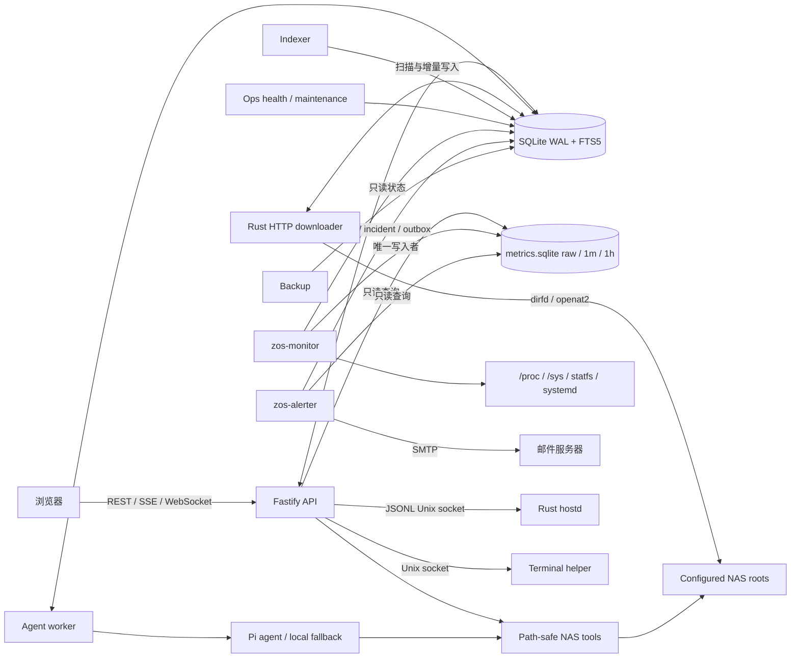

依赖方向是 `web -> api`，`api -> db/nas-tools/shared/system-health/monitoring`，`worker -> agent/db/shared`。Rust downloader、indexer、monitor 与 alerter 使用由 TypeScript migration catalog 管理的主 SQLite schema；monitor 只读主库并独占写入可重建的指标库，alerter 只读指标库并把规则、incident 和投递 outbox 写入主库。API 不采集指标、不评估规则、不发送邮件。systemd timers 仍是运维任务的唯一周期调度层；指标采样和告警求值由各自常驻进程使用单调时钟调度。ZOS 是多进程原生服务，不使用 Docker 作为自身部署边界。
