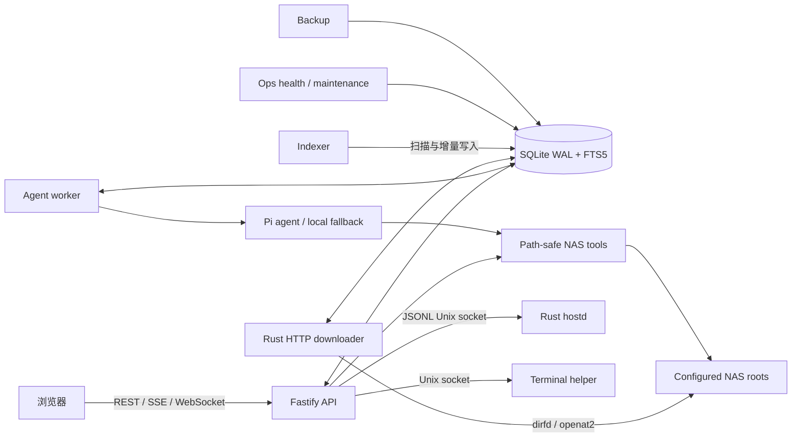

依赖方向是 `web -> api`，`api -> db/nas-tools/shared/system-health`，`worker -> agent/db/shared`；Rust downloader 与 Rust indexer 直接使用由 TypeScript migration catalog 管理的 SQLite schema，并通过 dirfd/`openat2` 访问 NAS。Ops 与 backup 同样共享 SQLite，systemd timers 是唯一周期调度层。ZOS 是多进程原生服务，不使用 Docker 作为自身部署边界。
