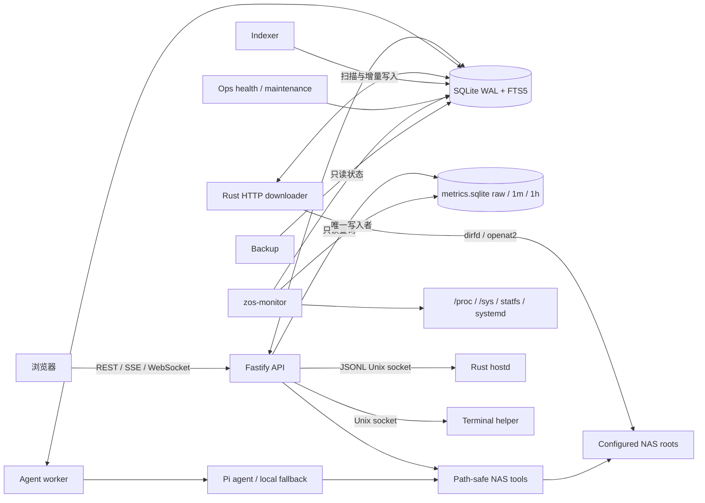

依赖方向是 `web -> api`，`api -> db/nas-tools/shared/system-health/monitoring`，`worker -> agent/db/shared`；Rust downloader 与 Rust indexer 直接使用由 TypeScript migration catalog 管理的主 SQLite schema，并通过 dirfd/`openat2` 访问 NAS。Ops 与 backup 共享主库。`zos-monitor` 独占可重建的指标库写入，API 与 Health 只读该库，因此高频采样和损坏隔离不会影响文件、索引、任务或备份状态。systemd timers 仍是运维任务的唯一周期调度层；监控采样由常驻 monitor 自身调度。ZOS 是多进程原生服务，不使用 Docker 作为自身部署边界。
